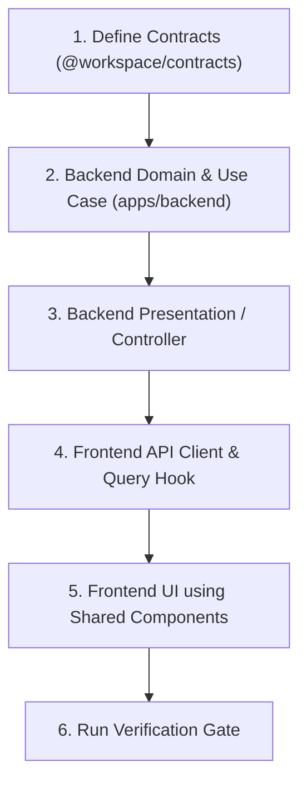

# NextNest Monorepo: Architecture, Modularity & Contribution Guide

This document is the **canonical specification** for extending and maintaining the NextNest monorepo. It details project structure, file placement rules, design system consumption, super-modularity standards, and development rituals for both human contributors and AI coding agents.

---

## 1. Monorepo Topology & Project Structure

The codebase is structured as a pnpm workspace orchestrated by Turborepo:

```
NextNest/
├── apps/
│   ├── backend/                      # NestJS 11 on Fastify 5 (Hexagonal Core API)
│   │   ├── src/
│   │   │   ├── core/                 # Cross-cutting infrastructure
│   │   │   │   ├── config/           # Validated environment schemas (env.schema.ts)
│   │   │   │   ├── crypto/           # Password hashing & cryptography (password-hasher.ts)
│   │   │   │   ├── database/         # Drizzle connection pools & schema definitions
│   │   │   │   ├── idempotency/      # Distributed idempotency state machine
│   │   │   │   ├── outbox/           # Transactional outbox relay & BullMQ integration
│   │   │   │   └── resilience/       # RFC 7807 exception filter & health probes
│   │   │   ├── modules/              # Domain bounded contexts
│   │   │   │   └── [feature]/        # e.g., ledger, auth, kyc, loans
│   │   │   │       ├── domain/       # PURE TS: Entities, value objects, domain events
│   │   │   │       ├── application/  # Use cases, command/query handlers, port interfaces
│   │   │   │       ├── infra/        # Drizzle repositories, external adapters
│   │   │   │       └── ui/           # Fastify HTTP controllers, OpenAPI documentation
│   │   │   ├── app.module.ts         # Root dependency injection container
│   │   │   ├── main.ts               # Fastify HTTP bootstrapper & plugin registrar
│   │   │   └── worker.ts             # Dedicated background outbox relay worker process
│   │   └── test/                     # Vitest unit, integration, and e2e test suites
│   │
│   └── frontend/                     # Next.js 15 (App Router, React 19, Tailwind v4)
│       └── src/
│           ├── app/                  # Next.js App Router route segments (page.tsx, layout.tsx)
│           ├── features/             # Domain business features (e.g. system-health, ledger)
│           │   └── [feature]/
│           │       ├── api/          # React Query query/mutation hooks
│           │       ├── model/        # Local state, types, view models
│           │       └── ui/           # Feature-specific composite components
│           └── shared/               # Reusable platform building blocks
│               ├── api/              # HTTP client, env validation, interceptors
│               ├── assets/           # Static icons and image references
│               ├── hooks/            # Focused single-purpose React hooks
│               ├── lib/              # Formatters, date math, math helpers, constants
│               ├── state/            # Global providers (QueryProvider, etc.)
│               └── ui/               # Canonical shared UI components & Radix re-exports
│
├── packages/                         # Shared workspace packages
│   ├── contracts/                    # Zod 4 schemas, DTOs, UUIDv7 primitives
│   ├── logger/                       # High-throughput Pino JSON logger with redaction
│   └── ui/                           # Headless Radix UI primitives & CVA design system
│
├── docker/                           # PostgreSQL 17, PgBouncer, Redis configurations
├── docs/                             # Architectural Decision Records (ADRs)
└── turbo.json                        # Pipeline task orchestration cache rules
```

---

## 2. Super-Modularity & File Size Doctrine

Monolithic files are strictly prohibited. Modularity ensures code review clarity, isolation of concerns, and zero AI context pollution.

### The Modularity Rules:
1. **Target File Size (< 100 - 150 Lines)**:
   - If any component, hook, or service exceeds 150 lines, split it into smaller sub-units.
   - Separate state machines/hooks from rendering logic.
2. **Single Responsibility per File**:
   - Each file must export exactly one primary concept (one hook, one entity, one component, or one schema group).
   - Never combine unrelated helper functions into a generic "kitchen sink" `utils.ts`. Create domain-specific modules (e.g., `formatters.ts`, `date-utils.ts`, `currency.ts`).
3. **Folder per Composite Entity**:
   - When a component requires sub-elements (e.g., `DataTable` with header, row, pagination, and filter), give it a dedicated directory:
     ```
     shared/ui/DataTable/
     ├── index.ts
     ├── DataTable.tsx
     ├── TableHeader.tsx
     ├── TableRow.tsx
     └── TablePagination.tsx
     ```

---

## 3. The "Shared-First" Component Doctrine

Feature developers and AI agents must **never construct raw HTML primitives** in feature code.

### ❌ What is FORBIDDEN:
```tsx
// NEVER DO THIS in features or pages:
<button className="bg-blue-500 text-white px-4 py-2 rounded">Submit</button>
<input type="text" className="border p-2" />
<div className="border rounded p-4 shadow">...card content...</div>
<select className="border">...</select>
```

### ✅ What is REQUIRED:
Always consume canonical components from `@workspace/ui` or `apps/frontend/src/shared/ui`:
```tsx
import { 
  Button, 
  Card, 
  CardHeader, 
  CardTitle, 
  CardContent, 
  InputField, 
  Select, 
  SelectTrigger, 
  SelectContent, 
  SelectItem,
  Badge,
  Alert
} from "@/shared/ui";

export function LoanApplicationForm() {
  return (
    <Card>
      <CardHeader>
        <CardTitle>Submit Loan Application</CardTitle>
      </CardHeader>
      <CardContent className="space-y-4">
        <InputField label="Applicant Full Name" placeholder="Jane Doe" />
        <Button variant="primary" size="md">Submit Application</Button>
      </CardContent>
    </Card>
  );
}
```

### Creating New Shared Components:
If a required design element does not exist:
1. Build it inside `packages/ui/src/` (if it is a headless design primitive) or `apps/frontend/src/shared/ui/` (if it is an application-level composite component).
2. Use **Class Variance Authority (`cva`)** for variant and size management.
3. Leverage `@radix-ui/*` primitives for accessibility, keyboard navigation, and ARIA compliance.
4. Export it in the directory's `index.ts` barrel file so it becomes immediately available monorepo-wide.

---

## 4. Next.js 15 App Router & RSC Rituals

### Server vs. Client Component Boundaries:
- **Default to React Server Components (RSC)**: Keep pages, layouts, and display components as Server Components (no `"use client"`). They render to HTML with **0 KB client JavaScript**.
- **Add `"use client"` only where strictly necessary**:
  - Components that consume React hooks (`useState`, `useEffect`, `useRef`).
  - Components with interactive browser event listeners (`onClick`, `onChange`, `onKeyDown`).
  - Interactive Radix primitives that mount to browser portals (e.g., `Dialog`, `Select`).

### Environment Variables:
- **Never use dynamic bracket access** like `process.env["NEXT_PUBLIC_API_URL"]` in client code. Next.js cannot inline bracket access at build time.
- Always validate client environment variables using Zod in `apps/frontend/src/shared/api/env.ts` with direct property access:
  ```ts
  export const clientEnv = ClientEnv.parse({
    NEXT_PUBLIC_API_URL: process.env.NEXT_PUBLIC_API_URL
  });
  ```

---

## 5. Backend Architecture & Security Rituals

### Hexagonal Domain Purity:
- All domain logic (`apps/backend/src/modules/*/domain/`) must be **100% pure TypeScript**.
- **Zero external framework or ORM imports**: The domain layer must NEVER import `@nestjs/*`, `drizzle-orm`, `fastify`, or database drivers.
- All domain identities use `UuidV7` from `@workspace/contracts`.

### Security Standards:
1. **Never Trust Proxy Headers Unconditionally**:
   - `trustProxy` in Fastify must use `env.TRUST_PROXY_HOPS` (default `0`), preventing client spoofing of `X-Forwarded-For`.
2. **Strict Body & Rate Limits**:
   - JSON payloads limited to 1MB; document uploads via `@fastify/multipart` strictly capped at 10MB.
   - Rate limiting enforced via `@fastify/rate-limit`.
3. **Password Security**:
   - Use `PasswordHasher` (`apps/backend/src/core/crypto/password-hasher.ts`) using `bcryptjs` with a minimum of 12 salt rounds.
4. **Data Redaction & Sanitization**:
   - All logs flow through `@workspace/logger` (Pino). Authorization headers, cookies, and sensitive fields are redacted before serialization.
5. **Transactional Dual-Write Safety**:
   - Never publish async events directly within an HTTP transaction. Always write to the `outbox` table in the same database transaction. The background relay worker (`worker.ts`) polls and dispatches events to BullMQ idempotently.

---

## 6. Agentic IDE / Contributor Step-by-Step Playbook

When adding a new feature or endpoint, follow this disciplined order:



### Step 1: Contracts First
Define request schemas, response schemas, and entities in `packages/contracts/src/[feature].contract.ts`. Export them from `packages/contracts/src/index.ts`.

### Step 2: Backend Domain & Use Case
1. Create domain entity in `apps/backend/src/modules/[feature]/domain/`. Include `rehydrate()` factory for ORM reads.
2. Implement use case in `apps/backend/src/modules/[feature]/application/`.
3. Write unit tests in `test/unit/` using Vitest.

### Step 3: Backend Controller & Infrastructure
1. Implement Drizzle repository in `infra/`.
2. Create controller in `ui/` with `@nestjs/swagger` decorators and `ZodValidationPipe`.
3. Verify with integration tests in `test/integration/`.

### Step 4: Frontend API & Hook
1. Create typed fetcher in `apps/frontend/src/features/[feature]/api/`.
2. Wrap in a TanStack Query hook (`useQuery` / `useMutation`).

### Step 5: Frontend UI
1. Assemble view in `apps/frontend/src/features/[feature]/ui/`.
2. Compose exclusively from `@workspace/ui` or `apps/frontend/src/shared/ui/`.
3. Never use raw HTML buttons, inputs, or cards.

### Step 6: Mandatory Verification Gate
Before committing or marking any task complete, all four gates must pass:
```bash
# In NextNest/ root:
pnpm run typecheck    # 0 errors across all 5 workspace projects
pnpm run lint         # 0 errors and 0 warnings
pnpm run test         # 100% test suites passing
pnpm run build        # Production builds of Next.js 15 & Fastify backend succeed
```

